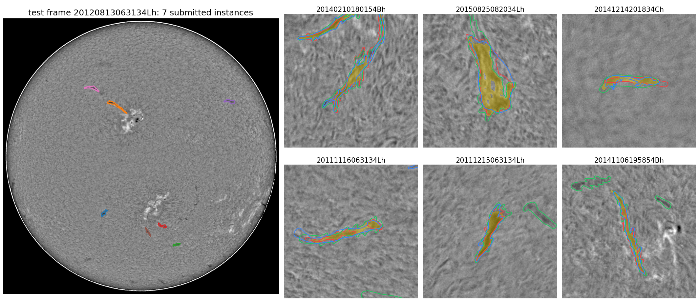
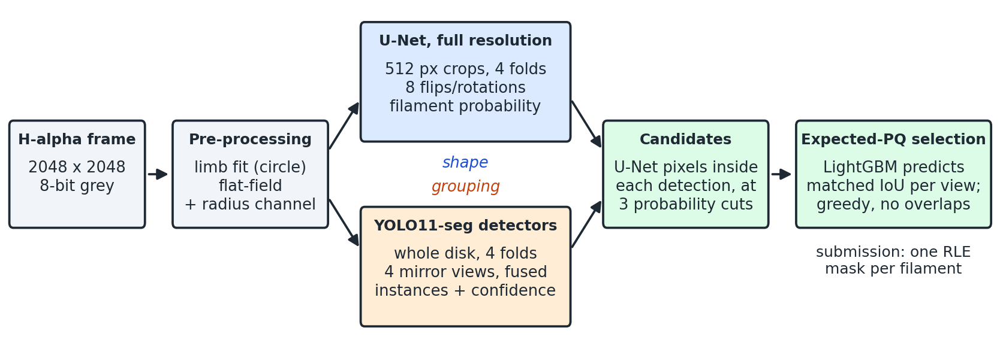

# Solar filament instance segmentation in GONG H-alpha images

Solution to the [Solar Filament Segmentation Challenge 2026](https://www.kaggle.com/competitions/filament-segmentation-2026)
(organized by the Earth-Space AI Research (ESAIR) Lab and sponsored by the NSF National Solar Observatory).



*Competition image source: [Solar Filament Segmentation Challenge 2026](https://www.kaggle.com/competitions/filament-segmentation-2026/data). The underlying H-alpha observations are from the Global Oscillation Network Group (GONG), obtained by the National Solar Observatory Integrated Synoptic Program (NSO/NISP). The montage is adapted for this project's report. See the [MAGFiLO dataset paper](https://doi.org/10.1038/s41597-024-03876-y) and the competition data page for dataset credits and terms. The underlying imagery is subject to its own terms.*

Each frame is a 2048 x 2048 full-disk H-alpha image; the task is one mask per
filament. Submissions are scored with Panoptic Quality (PQ) against every
annotator's drawing of a frame: a predicted mask counts only if its IoU with a
drawing exceeds 0.5.

* **Report:** [`report/main.pdf`](report/main.pdf) (4 pages)
* **Notebook:** [`notebooks/pipeline.ipynb`](notebooks/pipeline.ipynb) walks through the whole
  pipeline and rebuilds the submitted file from the weights in [`weights/`](weights) without
  retraining
* **Submitted predictions:** [`results/final_submission.csv`](results/final_submission.csv)

## Method in one paragraph

A U-Net working at full resolution says which pixels are filament. A YOLO11-seg
detector looking at the whole disk says which pixels belong to the same filament
and how likely an annotator is to draw it. Each detection claims the U-Net pixels
inside its mask, which gives candidate instances with accurate outlines. A small
gradient-boosted model then predicts, for every candidate, the quantity that the
metric rewards, and candidates are kept only while they are expected to raise PQ.
No ground truth other than the competition's training annotations is used
anywhere, and the test images are used for inference only.



## Results

All validation numbers are out-of-fold: the 707 training frames are split into
four folds by frame, and a frame is predicted by networks and by a selector that
were fitted without it. Intervals are 95 % bootstrap intervals over frames.

| | Frames | PQ [95 % interval] | DQ | SQ |
|---|---|---|---|---|
| **Out-of-fold, all training frames** | 707 | **0.453 [0.444, 0.462]** | 0.665 | 0.681 |
| frames drawn by 1 annotator | 411 | 0.459 [0.447, 0.470] | 0.667 | 0.688 |
| frames drawn by 2 annotators | 145 | 0.459 [0.441, 0.476] | 0.674 | 0.681 |
| frames drawn by 3 annotators | 151 | 0.444 [0.428, 0.460] | 0.658 | 0.675 |
| one annotator scored against the others | 296 | 0.340 [0.324, 0.356] | 0.536 | 0.634 |
| **Public leaderboard (test set)** | | **0.39** | | |

What each part contributes (out-of-fold PQ):

| Variant | PQ |
|---|---|
| Connected components of the U-Net output (no detector) | 0.416 |
| Detector masks (no U-Net) | 0.416 |
| U-Net pixels inside each detection, one detector, one view | 0.441 |
| + second detector and four mirror views | 0.447 |
| + three probability cuts and the learned selector (**full method**) | 0.453 |
| Oracle selection of the same candidates (upper bound) | 0.545 |

On the 151 frames drawn by three annotators, one annotator predicts another's
drawing with PQ 0.333, the filaments on which two annotators agree predict the
third annotator's drawing with PQ 0.323, and this pipeline predicts it
with PQ 0.444. The leaderboard score is consistently about 0.87 times the out-of-fold
score, for every submission made with this pipeline.

For orientation, scoring one annotator against the other annotators of the same
frame gives PQ 0.340 on the training set: the annotators themselves disagree
about which dark structures are filaments and where one ends, and that bounds
what any method can reach on this metric.

## Repository layout

```
filaseg/             the package
  config.py          paths and constants
  data.py            annotations, frames, views, cross-validation folds
  preprocess.py      limb fit, flat-fielding, cached network inputs
  rle.py             COCO run-length helpers
  metric.py          the competition's PQ on run-length masks
  unet.py            semantic network: model, training, tiled inference
  detector.py        YOLO11-seg wrapper: dataset export, training, prediction
  inference.py       run the networks over a subset and store their outputs
  candidates.py      network outputs -> candidate instances with features
  selection.py       expected-PQ scorer and greedy non-overlapping selection
  pipeline.py        glue: which network outputs belong to which frame
  submission.py      CSV writer and format checks
  reproduce.py       inference from the released weights
scripts/             one numbered script per stage (see below)
notebooks/           pipeline.ipynb and the script that generates it
weights/             released weights and manifest.json
results/             submitted file, out-of-fold predictions, metrics
report/              the 4-page report (LaTeX source and PDF)
kaggle_sessions/     how the training sessions on Kaggle were launched
tests/               unit tests (pytest)
```

## Setup

Python 3.11. Install PyTorch for your CUDA version first, then the rest:

```bash
pip install torch==2.11.0 torchvision==0.26.0 --index-url https://download.pytorch.org/whl/cu128
pip install -r requirements.txt
pytest -q            # 7 tests, no data needed
```

### Data

Download the competition data (needs a Kaggle account that has accepted the rules)
and unpack it so that the folders look like this:

```
data/MAGFiLO_1.0_Kaggle_2026/train/train_images/*.jpeg
data/MAGFiLO_1.0_Kaggle_2026/train/MAGFiLO_1.0_Annotations_kaggle2026_train.json
data/MAGFiLO_1.0_Kaggle_2026/test/test_images/*.jpeg
```

```bash
kaggle competitions download -c filament-segmentation-2026 -p data
unzip -q data/filament-segmentation-2026.zip -d data
```

A different location can be given with the environment variable `FILASEG_DATA`
(the folder that contains `train/` and `test/`). Outputs go to `outputs/`
(`FILASEG_OUT`), large scratch files to `outputs/work/` (`FILASEG_WORK`).

## Reproducing the submission (no training)

```bash
python scripts/07_predict_test.py          # writes outputs/submissions/submission.csv
```

Two configurations were submitted as final entries; both use the same networks and differ only in the
candidates the selector may choose from:

| Configuration | Candidates | Out-of-fold PQ | Public LB | Submitted file |
|---|---|---|---|---|
| `weights/manifest.json` | U-Net pixels inside each detection | 0.453 | 0.39 | `results/final_submission.csv` |
| `weights/manifest_components.json` | the same + whole U-Net components | 0.451 | 0.40 | `results/final_submission_components.csv` |

```bash
python scripts/07_predict_test.py --manifest manifest_components.json --out outputs/submissions/components.csv
```

The network outputs are cached, so the second configuration costs only a few minutes after the first.

or run [`notebooks/pipeline.ipynb`](notebooks/pipeline.ipynb) top to bottom, which does the
same and also shows every intermediate step, compares the rebuilt file with the
submitted one, and recomputes the validation numbers. A GPU is needed.

Inference on the 180 test frames takes 107 minutes on one RTX 3060 (12 GB). Rebuilt this way, the file matches the submitted one in all 1,164 instances (pixel-level agreement PQ 0.9998).

## Training from scratch

```bash
python scripts/01_preprocess.py                       # limb fit + flat-field, cached

# for each fold k in 0..3
python scripts/02_train_unet.py     --fold k --name r34 --encoder resnet34 --iterations 12000 --batch-size 12
python scripts/03_train_detector.py --fold k --name m1536 --weights yolo11m-seg.pt --imgsz 1536 --epochs 80 --batch 2  # add --gpu-fraction 0.97 on a 12 GB card
python scripts/03_train_detector.py --fold k --name s1280 --weights yolo11s-seg.pt --imgsz 1280 --epochs 60 --batch 4

python scripts/04_build_candidates.py --name main --unets r34 --detectors m1536 s1280
python scripts/05_fit_selector.py     --name main     # out-of-fold PQ, scorer, threshold
python scripts/06_make_submission.py  --name main     # outputs/submissions/main.csv
python scripts/08_evaluate.py --predictions outputs/candidates/main/oof_predictions.csv --out outputs/evaluation

# optional analyses used in the report, and packaging of the release
python scripts/09_ablation.py --unets r34 --detectors m1536 s1280     --predictions outputs/candidates/main/oof_predictions.csv --out outputs/evaluation/ablation.json
python scripts/11_threshold_by_group.py --name main --out outputs/evaluation/threshold_by_group.json
python scripts/10_package_release.py --name main --unets r34 --detectors m1536:1536 s1280:1280     --evaluation outputs/evaluation --ablation outputs/evaluation/ablation.json
```

Each training script trains on every frame outside fold `k`, then predicts fold
`k` (out-of-fold) and the test set, so stages 4 to 8 need no GPU.

| Network | Per fold, on one Tesla T4 |
|---|---|
| U-Net (`r34`), 12 000 iterations | 1.3 h |
| Detector `m1536`, 80 epochs | 5.5 h |
| Detector `s1280`, 60 epochs | 1.6 h |

Four folds, so about 34 GPU-hours in total; stages 4 to 9 run on a CPU in under an hour.
Folds 0 to 2 were trained on Kaggle (2 x T4), fold 3 on a local RTX 3060 with the same commands;
see [`kaggle_sessions/README.md`](kaggle_sessions/README.md).

## What was tried and did not help

* **Whole connected components** of the U-Net output as extra candidates: -0.002 out-of-fold
  (95 % interval -0.005 to +0.001), +0.01 on the public leaderboard, i.e. a tie; released as the
  second configuration (`manifest_components.json`).
* **A full-resolution detector** (YOLO11m-seg at 2048 px) as a third detector: -0.002 on the
  held-out frames of fold 3 (0.452 against 0.454); it matched 78.0 % of the drawings with some
  candidate against 77.7 % without it, so missed small filaments are not a detector-resolution problem.
* **A second U-Net** (ResNeXt-50 encoder) averaged with the first: +0.002 PQ, inside the noise;
  left out to keep inference short.
* **Shape post-processing** of the selected masks (filling holes, morphological closing, Gaussian
  smoothing of the outline, dropping small fragments): between 0.000 and -0.003 PQ.
* **Growing or shrinking the outline by one pixel**: 0.025 and
  0.031 PQ lower. The U-Net boundary already sits at the optimum,
  and this is how sensitive the metric is for objects ten pixels wide.
* **Selection knobs** (overlap limit 0.1 to 0.5, value threshold 0.20 to 0.28, larger or smaller
  trees): all within 0.001 PQ of each other.
* **A CNN that re-scores each candidate from its image crop** (ResNet-18 on five channels: image,
  flat field, U-Net probability, candidate mask, crop size), trained leave-one-fold-out and stacked with
  the selector: +0.0005 PQ. The selector's features already carry what the crop shows.

## Licence and acknowledgements

Code: MIT (see `LICENSE`). The detector is trained with
[Ultralytics](https://github.com/ultralytics/ultralytics) (AGPL-3.0) starting from
its COCO-pretrained YOLO11 weights; the U-Net uses
[segmentation_models_pytorch](https://github.com/qubvel-org/segmentation_models.pytorch)
with an ImageNet-pretrained encoder. Data: MAGFiLO (Ahmadzadeh et al., 2024,
doi:10.1038/s41597-024-03876-y), GONG H-alpha observations from the NSO
Integrated Synoptic Program.
